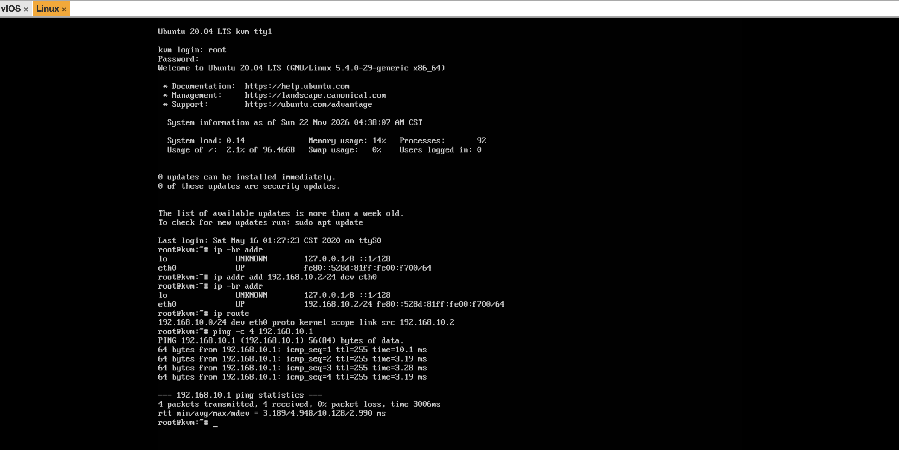
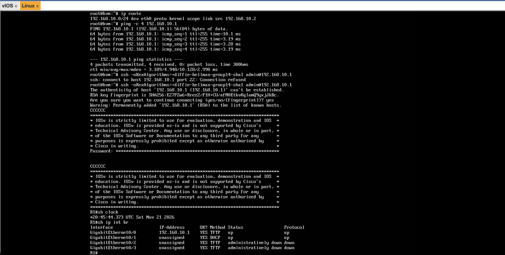
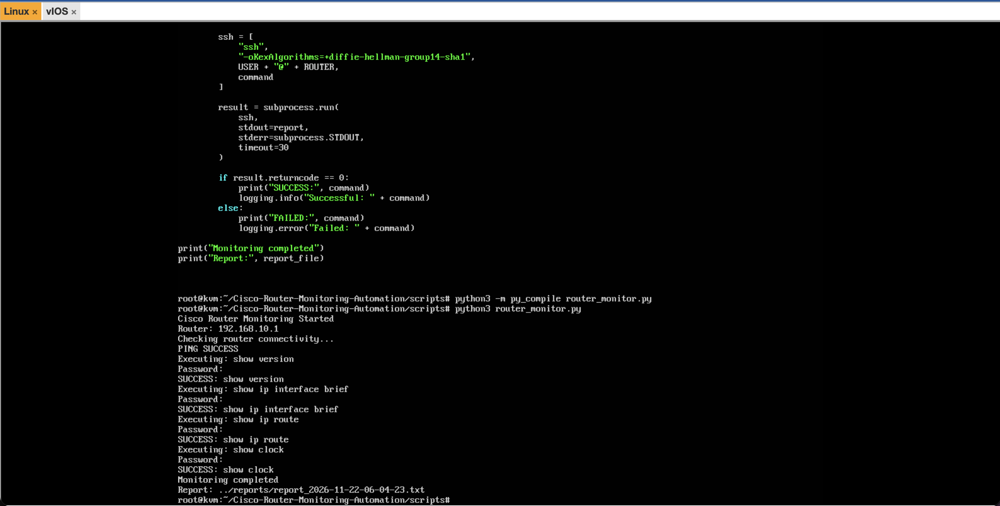
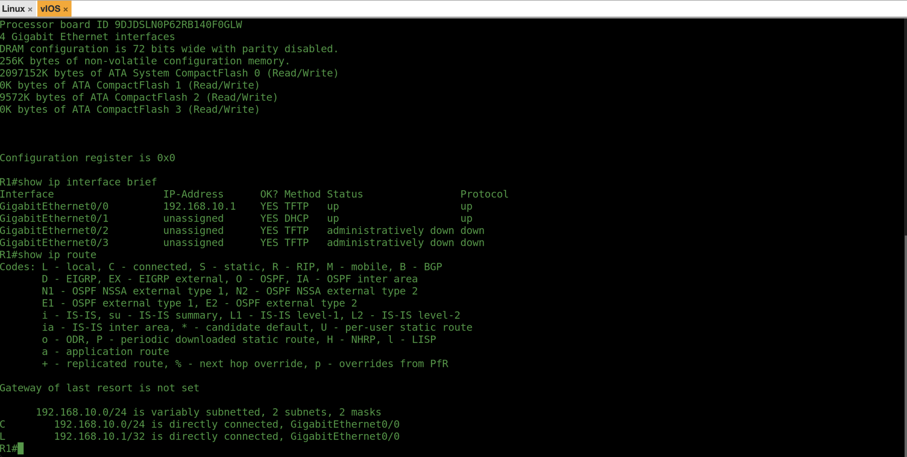
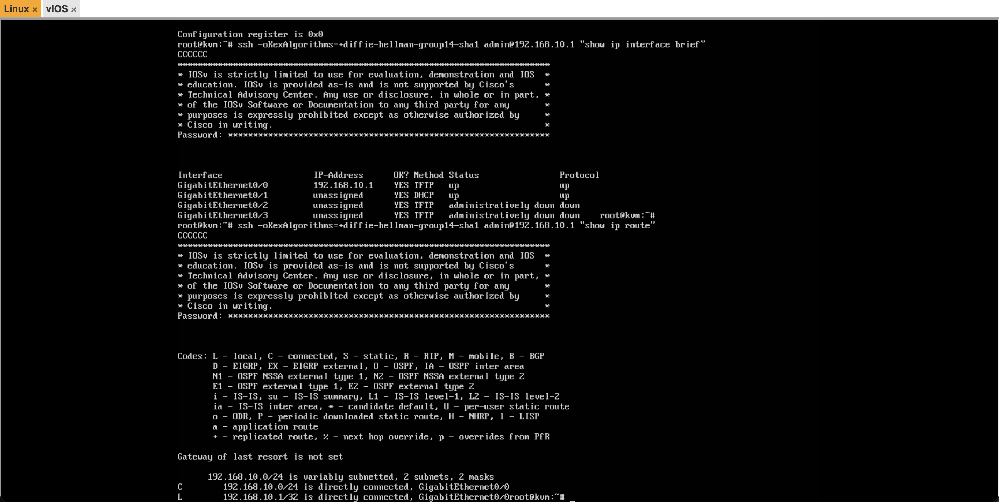
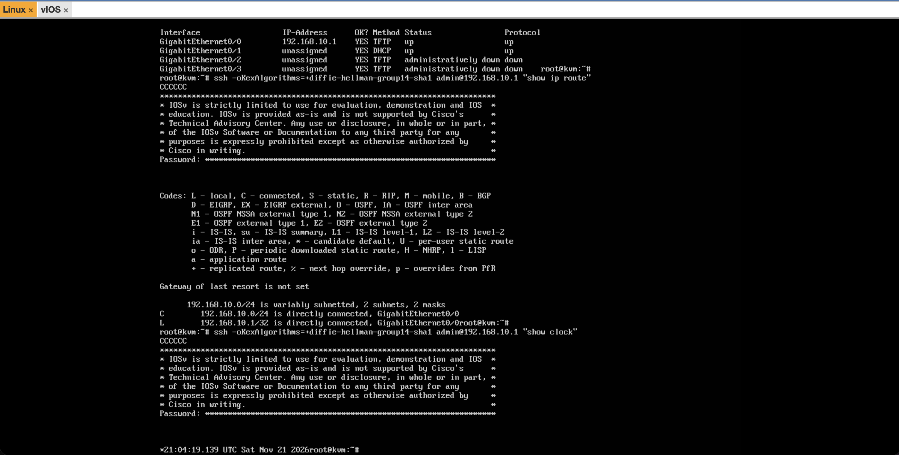

# Cisco Router Monitoring & Automation Using Python and SSH

*A hands-on network automation project exploring how Python and Linux can simplify routine Cisco router monitoring.*

---

## The Idea Behind This Project

Network administrators regularly perform routine checks on network devices: verifying interface status, inspecting routing tables, checking device information and confirming network reachability.

These tasks are often performed manually through command-line access.

But what if we could automate some of these routine checks?

That question became the starting point of this project.

I wanted to build a practical environment where a Linux machine could remotely access a Cisco router, execute monitoring commands through SSH, collect the results and generate structured reports using Python.

Rather than building a large enterprise environment, I decided to focus on one router and understand the complete monitoring workflow, from establishing connectivity to automating device information collection.

## What Are We Building?

The project combines three core technologies:

- **Cisco IOS:** The network device being monitored.
- **Linux:** The monitoring environment and SSH client.
- **Python:** The automation logic responsible for collecting and organizing device information.

The monitoring workflow:

1. Establish connectivity between Linux and the Cisco router.
2. Configure SSH access on the router.
3. Execute selected Cisco IOS commands remotely.
4. Collect device, interface and routing information.
5. Perform a network reachability check.
6. Generate timestamped monitoring reports and execution logs.

## Lab Environment

The project was implemented using PNETLab with a virtual Cisco IOSv router and a Linux node.

### Devices and roles

| Device | Purpose |
|---|---|
| Linux node | Python execution and remote monitoring |
| Cisco vIOS router (R1) | Device under monitoring |
| PNETLab | Virtual lab environment |

### Management addressing

| Device | Interface | IP address |
|---|---|---|
| Linux | eth0 | 192.168.10.2/24 |
| Cisco R1 | GigabitEthernet0/0 | 192.168.10.1/24 |

## Technologies Used

- Cisco IOSv
- PNETLab
- Linux
- Python 3
- OpenSSH
- VS Code

## What Does the Monitoring Script Do?

The Python monitoring program performs two main tasks.

### 1. Connectivity monitoring

It uses a ping test to check whether the router is reachable from the Linux monitoring node.

### 2. Router information collection

It establishes SSH connections and executes the following commands:

| Router command | Information collected |
|---|---|
| `show version` | Router platform and IOS information |
| `show ip interface brief` | Interface addresses and operational status |
| `show ip route` | Routing table information |
| `show clock` | Router date and time |

The Linux lab implementation wrote collected command output into a timestamped report and recorded execution results in a monitoring log.

## Implementation and Testing

The core monitoring workflow was successfully exercised in PNETLab.

The following results were observed:

- Linux was configured with `192.168.10.2/24`.
- Router R1 was configured with `192.168.10.1/24`.
- Linux successfully pinged R1 with 0% packet loss.
- SSH access from Linux to R1 was established.
- All four selected Cisco IOS commands were executed remotely.
- The Python monitoring script reported successful execution of the connectivity check and four monitoring commands.
- The script completed its monitoring session and generated a timestamped report.

The router's CLI outputs were also collected separately to document its software version, interface status, routing table and SSH configuration.

**Evidence note:** The report was generated inside the Linux lab, but retrieving and independently inspecting that file on the local Mac remains pending. The Mac-side repository copy of the script has passed Python syntax validation but has not been live-tested against the router.

## Screenshots and Lab Evidence

The following screenshots document selected stages of the implementation.

### 1. Connectivity test



### 2. SSH remote access



### 3. Python monitoring script



### 4. Router software information



### 5. Routing table



### 6. Router clock



## The Engineering Challenges

A virtual lab does not always behave as expected. Some of the most useful lessons came from the problems encountered during implementation.

### Connectivity and SSH

The initial SSH connection attempt was refused even though the router and Linux node were connected.

The issue required configuring SSH on the router, generating RSA keys and enabling local authentication on the VTY lines.

### SSH compatibility

The older SSH key-exchange algorithm supported by the virtual router required an additional compatibility option in the Linux SSH client.

### Python implementation

The initial approach involved transferring the Python script from the Mac to the Linux node. Network isolation between the local machine and the virtual lab complicated this process.

We eventually created the working script directly inside the Linux environment.

### File access and evidence collection

The monitoring report was generated inside the virtual Linux environment, but retrieving it onto the Mac proved difficult because the lab's internal network was not directly accessible from the host machine.

This highlighted an important operational lesson: generating a report and successfully preserving that report outside a temporary lab environment are two different tasks.

These challenges are documented in the troubleshooting journal.

## Project Structure

```text
Cisco-Router-Monitoring-Automation/
│
├── README.md
├── .gitignore
│
├── docs/
│   ├── implementation-notes.md
│   ├── troubleshooting-journal.md
│   └── router-command-outputs.txt
│
├── scripts/
│   └── router_monitor.py
│
└── screenshots/
    ├── 01-connectivity-test.png
    ├── 02-ssh-remote-access.png
    ├── 03-python-monitoring-script.png
    ├── 04-router-version.png
    ├── 05-routing-table.png
    └── 06-router-clock.png
```

## Project Status

**Core lab implementation: Successfully executed.**

The Linux-to-router connectivity, SSH access, remote command execution and Python monitoring workflow were exercised successfully.

Remaining improvements include:

- Testing the updated repository script against a live router.
- Retrieving and preserving the generated monitoring report and log.
- Improving report access and file-transfer handling.

## What I Learned

This project helped me connect networking fundamentals with practical automation.

Beyond configuring IP addresses and enabling SSH, I gained experience with Linux command-line operations, Python subprocess execution, remote device access, troubleshooting and automated report generation.

The most valuable lesson was understanding how individual networking and programming concepts work together in a practical monitoring workflow.

---

*This project is a hands-on exploration of network monitoring and automation using Cisco IOS, Linux, SSH and Python.*.*